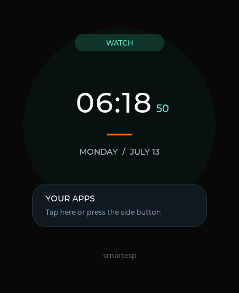
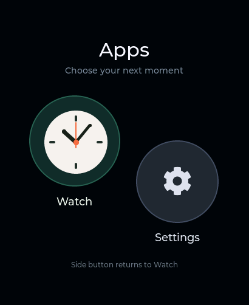
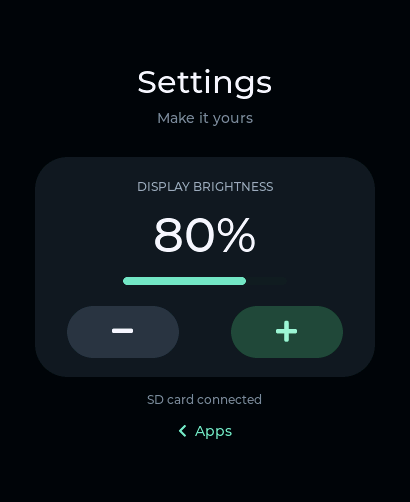

# SmartESP

SmartESP (`smart_os`) is an ESP-IDF smartwatch OS scaffold for the Waveshare ESP32-S3 Touch AMOLED 2.06 board, developed in the `smartesp` repository. It keeps the watch shell, boot flows, and sensitive shared UI native in C, while executing selected applications through [`fayasm`](https://github.com/Geckos-Ink/fayasm) as WebAssembly workloads.

The ESP-IDF project and OS component are named `smart_os`. Include `smart_os.h` and start the OS with `smart_os_start()` and `SMART_OS_DEFAULT_CONFIG()`; OS types/functions use `smart_os_*` and constants use `SMART_OS_*`. Firmware artifacts are `smart_os.bin` and `smart_os.elf`. Boot and Watch branding display **SmartOS**. The Watch app retains its name, app IDs and SD paths stay stable, and existing `watch_settings` NVS preferences, `/sdcard/smartesp/runtime/` spill storage, and `WATCH-UI` serial diagnostics remain compatible.

The target shape is a watch-class system closer to an Apple Watch than a generic LVGL demo:

- native C owns boot, loading, shared surfaces, and latency-sensitive operations
- WASM apps run through `fayasm` when they benefit from portability or sandboxing
- process policy distinguishes what must stay resident, what may hibernate, and what can be discarded under memory pressure
- SD-backed spill hooks are the intended path for hibernating WASM memory/JIT state when storage is available

## Screenshots

Captured from LVGL on the connected ESP32-S3 watch during the hardware smoke test. These captures predate the SmartOS branding change; the Watch footer now displays SmartOS.

| Watch | Apps | Settings |
| --- | --- | --- |
|  |  |  |

## Status

This repository now contains a buildable ESP-IDF project skeleton with:

- Waveshare BSP integration taken from the local `ESP32-S3-Touch-AMOLED-2.06` examples
- `fayasm` added as a Git submodule under `external/fayasm`
- an ESP-IDF component wrapper for `fayasm`
- a native watch shell in C for boot and an edge-safe, app-quality clock surface
- a WASM runtime layer with host bindings and SD-backed spill/load hooks
- a process manager that marks apps as `always resident`, `resident while active`, `hibernable`, or `disposable`
- a native circular app launcher opened with either side button, with tappable Watch and Settings icons
- SD-loaded Watch and Settings WASM apps executed through `fayasm`, with native LVGL presentation and persistent display brightness
- an updated `fayasm` runtime that preserves caller operands across nested WASM calls and avoids repeated JIT preparation for large function bodies, with native regression tests and matching Emscripten/Rust fixture validation

## Repository Layout

Use this map first when navigating the code:

- [`assets/`](assets/) contains device-captured PNG screenshots used above.

- [`main/main.c`](/Users/richard/Sources/GitHub/smartesp/main/main.c) starts NVS and launches the OS.
- [`components/smart_os/src/smart_os.c`](/Users/richard/Sources/GitHub/smartesp/components/smart_os/src/smart_os.c) is the top-level orchestrator.
- [`components/smart_os/src/board/`](/Users/richard/Sources/GitHub/smartesp/components/smart_os/src/board) contains board/display bootstrap helpers.
- [`components/smart_os/src/ui/`](/Users/richard/Sources/GitHub/smartesp/components/smart_os/src/ui) contains the native C watch shell and boot/loading UI.
- [`components/smart_os/src/kernel/`](/Users/richard/Sources/GitHub/smartesp/components/smart_os/src/kernel) contains the process catalog and residency policy logic.
- [`components/smart_os/src/runtime/`](/Users/richard/Sources/GitHub/smartesp/components/smart_os/src/runtime) contains the `fayasm` integration and host bindings.
- [`components/smart_os/src/storage/`](/Users/richard/Sources/GitHub/smartesp/components/smart_os/src/storage) contains SD/runtime blob helpers used for hibernation.
- [`components/smart_os/src/io/`](/Users/richard/Sources/GitHub/smartesp/components/smart_os/src/io) contains serial-side helpers, including the USB/UART WASM uploader that writes app payloads onto the SD card.
- [`components/smart_os/src/apps/`](/Users/richard/Sources/GitHub/smartesp/components/smart_os/src/apps) defines built-in app descriptors and the embedded demo WASM headers.
- [`components/fayasm_port/`](/Users/richard/Sources/GitHub/smartesp/components/fayasm_port) wraps upstream `fayasm` sources as an ESP-IDF component.
- [`wasm_apps/`](/Users/richard/Sources/GitHub/smartesp/wasm_apps) holds C sources compiled into SD-installable WASM apps; Watch also has an embedded recovery copy.
- [`scripts/build_clock_demo_wasm.sh`](/Users/richard/Sources/GitHub/smartesp/scripts/build_clock_demo_wasm.sh) is a compatibility entry point for `scripts/build_wasm_apps.sh`, which builds both apps and refreshes the embedded Watch recovery header.
- [`scripts/push_wasm_serial.py`](/Users/richard/Sources/GitHub/smartesp/scripts/push_wasm_serial.py) uploads an external `app.wasm` to `/sdcard/apps/<app>/app.wasm` over the same USB serial link used for logs.
- [`external/fayasm`](/Users/richard/Sources/GitHub/smartesp/external/fayasm) is the upstream runtime submodule. If you modify it, commit inside that repository.

## Runtime Model

The watch is intentionally split into two execution classes:

### Native C

Use native code for:

- boot and crash-safe loading sequences
- shared shell widgets and status chrome
- touch/display critical paths
- power, input, and notification daemons
- any operation where WASM overhead would harm latency or reliability

### WASM via `fayasm`

Use WASM for:

- app logic that benefits from isolation or portability
- disposable or restartable user apps
- workloads that can be paused, hibernated, or cold-loaded from storage

Current runtime policy categories:

- `SMART_OS_APP_RESIDENCY_ALWAYS_RESIDENT`: never swap out
- `SMART_OS_APP_RESIDENCY_RESIDENT_WHILE_ACTIVE`: keep warm while in active use
- `SMART_OS_APP_RESIDENCY_HIBERNABLE`: spill JIT/memory state to SD when needed
- `SMART_OS_APP_RESIDENCY_DISPOSABLE`: unload and recreate on demand

## Storage, External Apps, and Hibernation

SmartOS mounts the microSD card during boot when SD-backed runtime is enabled. FAT-formatted cards mount normally. If the card initializes but FatFs reports that it has no usable filesystem or that the filesystem is internally inconsistent, the device automatically repartitions and formats it as FAT before retrying the mount. This recovery is destructive to existing card contents; SDMMC transport/enumeration failures do not trigger formatting. Once mounted, the OS uses:

- `/sdcard/smartesp/runtime/` for `fayasm` spill blobs
- `/sdcard/apps/<app>/app.wasm` as the expected convention for external WASM apps

The mount is performed directly in [`storage.c`](/Users/richard/Sources/GitHub/smartesp/components/smart_os/src/storage/storage.c) rather than through `bsp_sdcard_mount()`. The 2.06" board wires the card in 1-bit SDMMC mode with no external pull-ups on CMD/D0, and the BSP helper leaves the internal pull-ups off, so the card fails to enumerate. The OS mounts with `SDMMC_SLOT_FLAG_INTERNAL_PULLUP` enabled, asks ESP-IDF to format only recoverable FatFs mount failures, and retries at the slow probing clock if the default clock fails.

If the card is missing or cannot be mounted, the system still boots with the embedded Watch recovery copy. SD-backed hibernation and WASM installation stay unavailable, Settings shows an installation error, and serial UI diagnostics remain available.

### Apps and navigation

Press either **PWR** or **BOOT** during normal operation to open the Apps screen. Tap the circular **Watch** or **Settings** icon to launch it. Press a side button again while in Apps to return to Watch; from Settings it returns to Apps. The Watch face also has a tappable “Your apps” card. PWR retains the board's hardware long-press power-off behavior.

The native launcher uses an offset cluster of large circular icons, circular hit regions, and pressed feedback. It advertises only the two implemented user apps; runtime demos and the Workout placeholder remain internal catalog entries. Boot, shared navigation, error screens and display operations stay in C. All app execution and navigation requests are serialized on the OS maintenance task through a FreeRTOS queue. GPIO0 (BOOT, active low) has 40 ms debounce. PWR uses TCA9554 EXIO6 (active high at `0x20`) when available, or AXP2101 (`0x34`) short-press IRQ polling on older boards, including the connected reference board. The PMIC path enables bit 3 at `0x41` and acknowledges only the short-press bit at `0x49`; GPIO35 stays reserved for octal PSRAM. Input remains independent of the one-second Watch tick. Board button wiring follows the [Waveshare hardware documentation](https://www.waveshare.com/wiki/ESP32-S3-Touch-AMOLED-2.06).

Watch runs only while its face is visible. The foreground process is protected from memory-pressure eviction; the background Watch is hibernable. Settings is disposable and explicitly unloaded when leaving it. Clock ticks never navigate away from Apps or Settings.

Settings offers brightness controls in 20% steps, bounded to 20–100%. Its WASM app calculates the next value; native C validates and applies it to the AMOLED and persists it in NVS (`watch_settings/brightness`). The default is 80%. The screen also reports whether the SD card is connected. Failed app loads show a recoverable error with a return to Apps.

The native UI keeps boot content and clock chrome inside the panel's rounded visible area. The active clock surface uses a fixed vertical safe region from 58 px through 442 px and centers all wide content, so neither top nor bottom glyphs enter the hidden corner arcs.

The display bootstrap deliberately bypasses the BSP's `bsp_display_start_with_config()` helper while continuing to use its SH8601 panel and FT5x06 touch drivers. The helper registers this QSPI panel through LVGL's RGB-display path, which does not wait for SPI color-transfer completion and can reuse a draw buffer while it is still in flight. `smart_os_board.c` registers it through `lvgl_port_add_disp()` instead, rounds every invalidated area to the SH8601's required even boundaries, and keeps the AMOLED dark until LVGL has flushed the first complete frame. This prevents transient or persistent purple horizontal bands at the top of the panel.

The ESP-IDF main task uses an 8 KiB stack because boot now owns the explicit panel, LVGL port, and touch initialization call chain before handing periodic work to the maintenance task.

### Serial WASM Install

Until Wi-Fi distribution exists, external WASM payloads can be pushed over USB serial directly onto the SD card. Firmware uses native USB Serial/JTAG as the primary console, with buffered interrupt-driven RX/TX so commands can arrive over multiple USB packets. Serial input accumulates complete lines before parsing; an overlong line is discarded through its newline. The previous UART-primary/USB-secondary setting only mirrored output and could not accept USB uploads. Firmware exposes a simple line-based uploader over stdio:

- `WASM-UPLOAD BEGIN <app> <bytes>`
- `WASM-UPLOAD DATA <hex>`
- `WASM-UPLOAD END`
- `WASM-UPLOAD ABORT`

Use the helper script:

```bash
./scripts/push_wasm_serial.py --port /dev/cu.usbmodem101 --app workout wasm_apps/build/clock_demo.wasm
```

If `--port` is omitted, the script tries `/dev/cu.usbmodem*` first and then `/dev/tty.usbmodem*`.

## Built-In Demos

The built-in `wasm.demo.add` application embeds a tiny WASM module that imports `env.host_add` and exports `run`. This demonstrates:

- loading WASM from memory
- binding native host functions
- executing an exported function through `fayasm`
- capturing the last result for the native shell

The user-facing catalog is:

| App | ID | SD payload | Residency |
| --- | --- | --- | --- |
| Watch | `wasm.demo.clock` | `/sdcard/apps/watch/app.wasm` | Hibernable in background |
| Settings | `wasm.settings` | `/sdcard/apps/settings/app.wasm` | Disposable on exit |

Watch starts at boot. Its C source is [`wasm_apps/clock_demo/clock_demo.c`](/Users/richard/Sources/GitHub/smartesp/wasm_apps/clock_demo/clock_demo.c). It imports `env.host_time_ms`, converts it to `HHMMSS`, and returns that value through `fayasm` once per second while visible. If no valid wall clock has been restored, the OS seeds it from the firmware build timestamp. Native C renders the time and date.

Settings lives in [`wasm_apps/settings/settings.c`](/Users/richard/Sources/GitHub/smartesp/wasm_apps/settings/settings.c). Both apps export `run() -> i32`. Settings imports `env.host_app_action() -> i32` (`-1` dim, `0` open, `1` brighten) and `env.host_app_value() -> i32` (current brightness percentage), then returns the clamped next percentage. Only the native OS accesses hardware and NVS.

The loader prefers a catalog app's installed SD payload. Watch falls back to its generated embedded header only when its SD file is absent; an invalid installed file produces an error instead of silently masking a broken installation. Settings requires its SD payload. Uploading replaces the file for the next cold load; reset after updating Watch so its existing context reloads.

Build and install both apps after source changes:

```bash
# Activate your Emscripten SDK first (emcc must be on PATH).
./scripts/build_wasm_apps.sh
./scripts/push_wasm_serial.py --port /dev/cu.usbmodem101 --app watch wasm_apps/build/watch.wasm
./scripts/push_wasm_serial.py --port /dev/cu.usbmodem101 --app settings wasm_apps/build/settings.wasm
```

`build_clock_demo_wasm.sh` remains a compatibility alias for the complete app build. The generated `clock_demo_wasm.h` is the Watch recovery copy; SD payloads are in ignored `wasm_apps/build/`.

## Build

1. Initialize the submodule:

```bash
git submodule update --init --recursive
```

2. Build (validated with ESP-IDF 6.1):

```bash
./scripts/build_wasm_apps.sh
source /Users/richard/.espressif/tools/activate_idf_v6.1.sh
idf.py set-target esp32s3
idf.py build
```

3. Flash and monitor:

```bash
idf.py flash monitor
```

When changing the runtime submodule, also run its native fixture/test matrix:

```bash
cd external/fayasm
./build.sh
```

The suite's `integer_ops` real-toolchain fixture covers signed division/remainder, i32/i64 rotate and bit-count operations, typed i64 calls, and nested-call operand preservation under both Emscripten and the Rust fallback. The upstream `stats_suite` fixtures also cover statistical and algorithmic workloads and guard against repeated JIT preparation for bodies larger than the per-chunk operation budget. Inspect the harness output for current coverage and skipped fixtures rather than relying on a manually maintained test total.

## Validation Script

Use the shell validation runner in [`tests/test_idf_build.sh`](/Users/richard/Sources/GitHub/smartesp/tests/test_idf_build.sh).

Compile-only validation:

```bash
./tests/test_idf_build.sh
```

Incremental rerun without `fullclean`:

```bash
./tests/test_idf_build.sh --no-clean
```

Compile + flash + serial smoke validation:

```bash
./tests/test_idf_build.sh --flash --monitor --port /dev/cu.usbmodemXXXX
```

External WASM transfer after flashing:

```bash
./scripts/push_wasm_serial.py --port /dev/cu.usbmodem101 --app workout wasm_apps/build/clock_demo.wasm
```

Default ESP-IDF path (override with `IDF_PATH` or `--idf-path`; the validation runner auto-selects the local EIM activator for the default path, accepts an explicit `IDF_ACTIVATE_SCRIPT`, and uses `export.sh` for other IDF paths):

- `/Users/richard/esp-idf/esp-idf-v6.1/v6.1/esp-idf`

The built-in `smoke-ui` scenario validates native UI/runtime milestones through serial logs. In non-interactive environments, the script falls back to a direct raw serial capture instead of `idf_monitor`.

- `boot-ui stage="display ready" progress=10`
- `boot-ui stage="launching clock" progress=100`
- `clock demo wasm.demo.clock time=`
- `clock-ui rendered time=`
- `SmartOS started`

Validate the compiled WASM app results with `node tests/test_wasm_apps.mjs`.

After flashing, installing both apps and resetting to Watch, run:

```bash
./tests/test_launcher_hardware.sh --port /dev/cu.usbmodem101
```

This exercises the real ESP32's LVGL pointer hit testing and shared button navigation, checks SD-loaded Settings and brightness changes, and captures Apps, Settings and Watch screenshots as PPM files under `/tmp/smartesp-ui/`. It leaves the device on Watch and restores the initial brightness. It does not physically actuate the switches or touch sensor.

For individual diagnostics use `scripts/watch_ui_serial.py --port /dev/cu.usbmodem101 button`, `tap 292 299`, or `--output /tmp/apps.ppm snapshot`. Firmware commands are `WATCH-UI BUTTON`, `WATCH-UI TAP <x> <y>`, and `WATCH-UI SNAPSHOT`. Snapshot data comes from the device's LVGL render tree (`CONFIG_LV_USE_SNAPSHOT=y`), with RGB565 hex rows. Serial diagnostics are development interfaces and remain native. The serial/diagnostic task has a 12 KiB stack to accommodate synchronous LVGL snapshot rendering and yields periodically while streaming the frame so the idle watchdog remains serviced. Host protocol parsers recover markers after truncated buffered console logs when USB is reopened.

## Contributor and Agent Workflow

Read [AGENTS.md](AGENTS.md) before changing the repository. It maps file ownership and meaningful symbols, cross-file features, implementation contracts, recurring pitfalls, exact validation workflows, and known test gaps. Compare its claims with the owning code and preserve unrelated working-tree changes. Read the [upstream instructions](external/fayasm/AGENTS.md) before editing `fayasm`.

Keep changed handbook facts synchronized in the same edit batch as the source or workflow change, and update this README whenever architecture, workflow, build steps, or runtime behavior changes. Update feature status, interface/test ownership, and reusable failure-prevention guidance together; record future work below rather than presenting it as implemented. Before each commit, check the full diff, local documentation links, exact commands and focused validation, and include the handbook update with the change it documents. Report checks that could not run, especially ESP-IDF builds and hardware validation.

## Notes for Future Work

- Add a manifest parser for external apps under `/sdcard/apps`.
- Move the process manager from synchronous demo orchestration to long-lived tasks/process supervision.
- Harden hibernate/resume/trap error propagation and add SmartOS memory-pressure and failure-injection coverage. Current lifecycle wrappers discard upstream spill/load statuses, so the hooks do not guarantee failure-safe checkpoints or full process restoration across boots.
- Add focused integration checks for reboot brightness persistence, missing/corrupt installed modules, malformed serial transfers, and power-loss-safe app replacement. Current upload replacement unlinks the old payload before renaming the temporary file; installation is an unsigned, unauthenticated development interface.
- If `fayasm` needs changes, make them in [`external/fayasm`](/Users/richard/Sources/GitHub/smartesp/external/fayasm) and commit there directly, then update the submodule pointer here.
